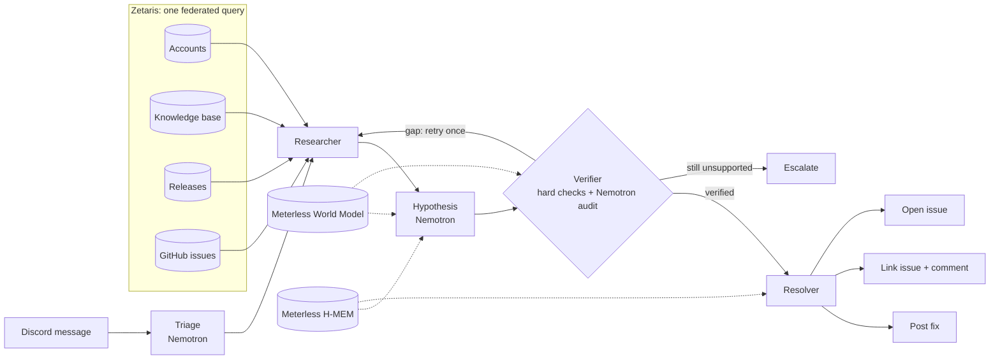

# Resolve

**A support agent that investigates, decides, acts, and knows when to stop.**

Resolve lives in a Discord support channel. When a customer reports a problem, it
investigates across four separate systems (the account record, the support knowledge
base, the release history, and the GitHub issue tracker), decides what is wrong,
checks every claim against a source row, and then does what a support engineer would
do: posts the verified fix, links the customer's report to the matching GitHub issue,
opens a new bug report, or hands off to a human with an evidence packet.

Open Agent Hackathon 2026 · Track 1: **Solving Fragmented Intelligence**

> **CloudNest** is a fictional file-sync product we created for the demo. All accounts,
> KB articles, releases and issues are synthetic; no real customer data is used.
> Issue #1 lives in a real public repository,
> [resolve-hackathon/cloudnest](https://github.com/resolve-hackathon/cloudnest).

---

## The problem

Answering one support question usually means opening three or four systems: who is
this customer and what version are they on, what changed in that version, is there a
known bug, is there a documented fix. Most support bots only search the docs and
guess, so they fail on exactly the questions that matter: the ones caused by a recent
release or a known bug. And when they are wrong, they are confidently wrong.

## What Resolve does

| Customer says | Resolve finds | Resolve does |
| --- | --- | --- |
| "Desktop sync stopped after the update" | Account on 3.8.1, the 3.8.1 sync rewrite, open issue #1 | Posts the workaround and **comments on GitHub issue #1** with the report |
| "Sync is still stuck" (same customer, later) | Its own memory of the first report | Answers, **without commenting on the issue twice** |
| "Why is my export blank?" | Account on 3.7.4, KB article for 3.7.x | Posts the three fix steps with a link to the article |
| "Uploads crash since 3.8.2" | A documented 3.8.2 upload regression, no open issue | **Opens a new GitHub issue** with the evidence |
| "My workspace turns purple at midnight" | Account on 3.8.2, the theme-schedule KB article | Posts the steps to turn off the scheduled theme |
| "The desktop app shows all my folders in Spanish" | Nothing that supports an answer | Retries once, then **escalates** with an evidence packet |
| Anything, from an unlinked Discord user | No account | Escalates; never trusts an account ID typed in chat |

Every reply cites its source. Every decision is logged with the rows that support it.

## How it works



1. **Triage** (Nemotron) reads the message in plain language and picks the product
   area from a fixed list. Refund and "talk to a human" requests go straight to a
   person. If the model is unavailable, a keyword fallback takes over.
2. **Researcher** sends one SQL statement through **Zetaris** that joins the four
   sources in place, scoped to this customer's account, product area, and version.
3. **Hypothesis** (Nemotron) chooses one of four allowlisted actions. Its claims
   *point at* source fields rather than retyping them, so it cannot misquote a fix.
4. **Verifier** runs hard checks (every claim maps to a real row and field, the fix
   applies to this client version, the issue is open and affects this version, a new
   bug needs a documented regression) and then an independent Nemotron audit. A gap
   sends the researcher back once; a second failure escalates.
5. **Resolver** executes the action through fixed handlers. The model never writes an
   API call. Live writes are re-read to confirm they happened, and a journal keyed by
   question ID prevents duplicate issues after a timeout.

## Sponsor technology

| Sponsor | What we built with it | Where |
| --- | --- | --- |
| **Zetaris** | The four sources are four separate databases, registered as four Zetaris datasources. The researcher sends one federated statement over the Zetaris REST API. The query plan shows four independent scans with filters **pushed down to each source**: nothing is copied. | `resolve/zetaris.py`, `sql/research_zetaris.sql`, `zetaris/`, [query plan](docs/evidence/zetaris_query_plan.txt) |
| **Meterless: World Model** | `WorldStoreService`, `IngestPipelineService`, `ContextBuilderService`. Every Zetaris row becomes an entity with provenance (source, row, via) and agent attribution (role, run, attempt), with typed relationships. The context builder's payload is what Nemotron reasons over. | `resolve/world_model.py`, `logs/world.jsonl`, `logs/run_manifest.jsonl` |
| **Meterless: H-MEM** | `MemoryStoreService`, `MemoryRetrievalService`. Tiered memory with warm start and hybrid retrieval. Prior resolutions are injected into the model context, and a confirmed earlier report stops Resolve from commenting on the same issue twice. | `resolve/memory.py`, `logs/memory_audit.jsonl` |
| **NVIDIA Nemotron** | `nvidia/nemotron-3.5-super-vl-120b-a12b` on build.nvidia.com does triage, the hypothesis, and the independent verifier audit. | `resolve/reasoning.py` |

Details for each integration, including what is not implemented:
[docs/INTEGRATIONS.md](docs/INTEGRATIONS.md). Machine-readable summary: [metadata.json](metadata.json).

---

## Run it in two minutes (no keys)

Python 3.9 or newer. No API keys, Docker, or packages are needed for the offline
demo, evaluation, and tests. On Windows, use `py` instead of `python3`.

```bash
git clone https://github.com/resolve-hackathon/resolve-agent.git
cd resolve-agent
python3 -m resolve demo --trace
python3 -m resolve eval
python3 -m unittest discover -s tests
```

`demo` runs four scenarios end to end and prints each full task state, including the
`events` trail and the World Model context. `eval` runs 12 labelled questions. Both use
the deterministic offline baseline and dry-run actions, so they never contact any
service, even if you have configured one.

Try single questions:

```bash
python3 -m resolve ask --customer-id c-031 "Desktop sync stopped after the update" --trace
python3 -m resolve ask --customer-id c-002 "Why is my export blank?"
python3 -m resolve ask --customer-id c-003 "I can reproduce an upload crash after 3.8.2"
python3 -m resolve ask --customer-id c-004 "The desktop app shows all my folders in Spanish"
```

Expected: `link_issue`, `post_fix`, `open_issue`, `escalate`.

## Full setup

Copy the config and edit it: `cp .env.example .env`. Never commit `.env`.

### 1. Nemotron

Create a key at [build.nvidia.com](https://build.nvidia.com/settings/api-keys), then:

```dotenv
RESOLVE_MODEL_MODE=compatible
MODEL_BASE_URL=https://integrate.api.nvidia.com/v1
MODEL_API_KEY=nvapi-...
MODEL_NAME=nvidia/nemotron-3.5-super-vl-120b-a12b
MODEL_TIMEOUT_SECONDS=60
```

Any OpenAI-compatible endpoint works the same way. Model calls retry once after a
pause; a malformed or unavailable answer escalates rather than guessing.

### 2. Zetaris

Requires Docker with 8 GB of memory. On Apple Silicon, enable Rosetta in Docker Desktop.

1. From Zetaris Cloud Gateway, choose **Run locally**, download the bundle, and run its
   `docker login` command. In the bundle folder: `./preflight.sh`,
   `docker compose pull`, `docker compose up -d`, `./verify.sh`.
2. Load the four sources into four separate databases:
   ```bash
   python3 zetaris/export_csv.py
   ZETARIS_BUNDLE=/path/to/zetaris-platform ./zetaris/load_postgres.sh
   ```
3. In the Zetaris SQL editor (http://localhost:3000), run `zetaris/register.sql` one
   statement at a time, with the bundle's `POSTGRES_PASSWORD` filled in. The last
   statement is a smoke test across all four sources.
4. Create an API token (Management, then API Tokens) and set:
   ```dotenv
   RESOLVE_RESEARCH=zetaris
   ZETARIS_REST_URL=http://localhost:8888/api/v1.0
   ZETARIS_ORG_ID=1
   ZETARIS_API_KEY=...
   ```

Rerun step 2 after editing anything in `data/`. Without Zetaris, `RESOLVE_RESEARCH=local`
runs the same SQL against a local SQLite snapshot: that is the fallback, not federation.

### 3. Discord bot

1. Create an application at the Discord developer portal, add a bot, and enable the
   **Message Content** intent. Invite it with View Channels, Send Messages, Send
   Messages in Threads, and Read Message History.
2. Make a `#support` channel and a private `#support-escalations` channel that the bot
   can write to.
3. Link a test user to a customer in `data/discord_links.local.json` (ignored by
   Git), for example `{"c-031": "<their Discord user ID>"}`, then run
   `python3 -m resolve seed` and reload Zetaris (step 2 above). Unlinked users are
   always escalated.
4. Configure and run:
   ```dotenv
   DISCORD_TOKEN=...
   DISCORD_GUILD_ID=...
   DISCORD_SUPPORT_CHANNEL_ID=...
   DISCORD_ESCALATION_CHANNEL_ID=...
   ```
   ```bash
   python3 -m venv .venv && source .venv/bin/activate
   python3 -m pip install --upgrade pip && pip install -e ".[discord]"
   python3 -m resolve bot
   ```
   In `#support`, type `!resolve your question` or mention the bot. Without `--live`,
   replies are marked `[DRY RUN]` and nothing is written to GitHub.

### 4. Live actions

Live mode needs **both** the flag and the setting, so it cannot be switched on by accident:

```dotenv
RESOLVE_ALLOW_LIVE_ACTIONS=true
GITHUB_TOKEN=github_pat_...      # fine-grained, Issues: read and write, demo repo only
GITHUB_REPOSITORY=resolve-hackathon/cloudnest
```

```bash
python3 -m resolve bot --live
# or one question from the CLI:
python3 -m resolve ask --live --question-id demo-1 --customer-id c-003 "Uploads crash since 3.8.2"
```

Reusing a question ID never repeats a write. After a timeout, check GitHub before
retrying with a new ID.

## Safety and honesty by design

- **Identity comes from the sender, never the message.** A customer ID typed in chat
  is ignored; unknown senders escalate. Nobody can ask about someone else's account.
- **The model cannot act directly.** It picks one of four actions; fixed handlers
  perform them in one configured repository. Customer text is marked untrusted in
  every prompt and every issue body.
- **No answer without a source.** Replies use the exact remedy text from the source
  row. Unsupported claims fail verification.
- **Writes are confirmed.** Comments and issues are re-read after creation. Failed or
  partial actions are reported as failed, never as done.
- **Knowing when not to act** is a feature: ambiguous, unsupported, billing, and
  unknown-sender cases escalate with everything a human needs.

## Evidence for judges

| File | Shows |
| --- | --- |
| [docs/evidence/zetaris_query_plan.txt](docs/evidence/zetaris_query_plan.txt) | Zetaris physical plan: four datasource scans, pushed-down filters |
| [docs/evidence/live_run_zetaris_nemotron.txt](docs/evidence/live_run_zetaris_nemotron.txt) | Four scenarios run through live Zetaris and Nemotron, with full event trails |
| `logs/world.jsonl`, `logs/run_manifest.jsonl` | World Model entities, relationships, decisions, and wired services (written at run time) |
| `logs/memory_audit.jsonl` | H-MEM writes per run (written at run time) |
| `tests/` | 40 tests: outcomes, verification gates, API failures, model misbehavior, memory, plain-language questions |

## Project layout

```text
resolve/
  agent.py          Five roles, one bounded retry, engine wiring
  reasoning.py      Triage, Nemotron adapter, prompts, hard verifier
  research.py       Research contract, version logic, local fallback
  zetaris.py        Zetaris REST researcher
  world_model.py    Meterless World Model engine
  memory.py         Meterless H-MEM engine
  actions.py        Four action handlers, receipts, action journal
  discord_bot.py    One-server Discord entry point
sql/                Research and identity queries (local and Zetaris)
zetaris/            Export, load, and datasource registration
data/               Synthetic CloudNest accounts, KB, releases, issues, eval cases
tests/              Unit and acceptance tests
docs/               Integration notes and evidence
```

## Limitations

- Product-area scoping and version ranges are exact; version tags must be
  `major.minor.patch`.
- GitHub issues are read from a snapshot loaded into Zetaris, not synced continuously.
  Live writes always re-read the real issue first.
- Questions that match two articles equally (for example "I can't log in") escalate
  rather than guess.
- Not implemented: World Model enrichment and control plane; H-MEM dreaming, sleep and
  conflict resolution; the Meterless Markovian engine.

## What's next

- `!link` command so customers verify their own account with a one-time code
- Clarifying questions for ambiguous reports instead of escalating
- Live GitHub issue sync into Zetaris, and Slack as a second channel
- Duplicate-issue detection across customers

## Pre-existing components

None. All code and data in this repository were written during the build window
(from 22 October 2026). Open-source dependency: `discord.py` (optional, for the bot).

## License

MIT. See [LICENSE](LICENSE).
